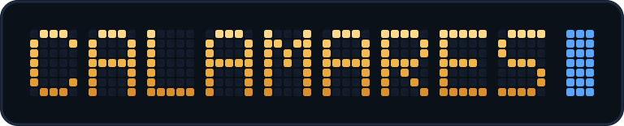
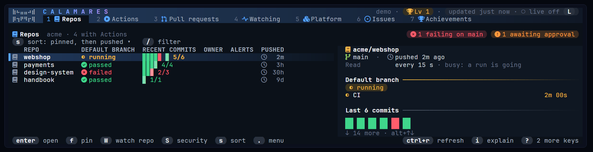
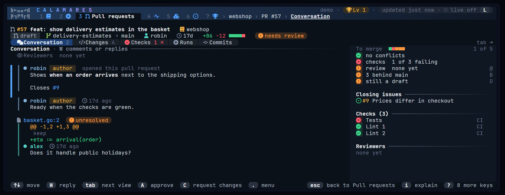
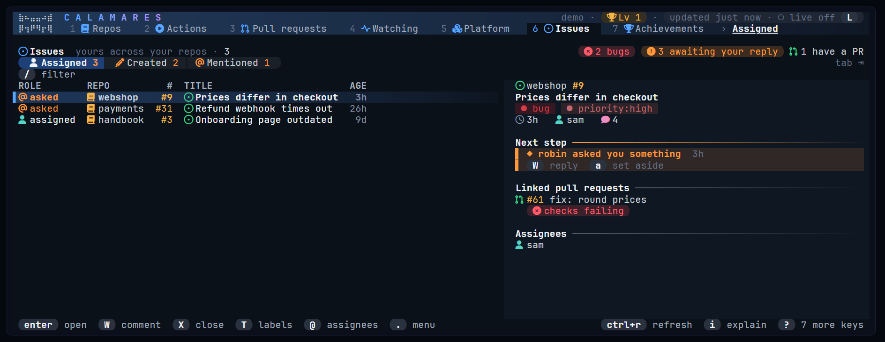
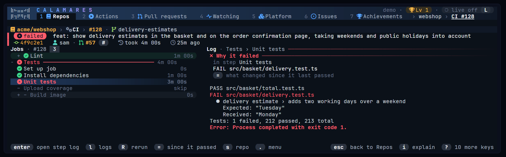
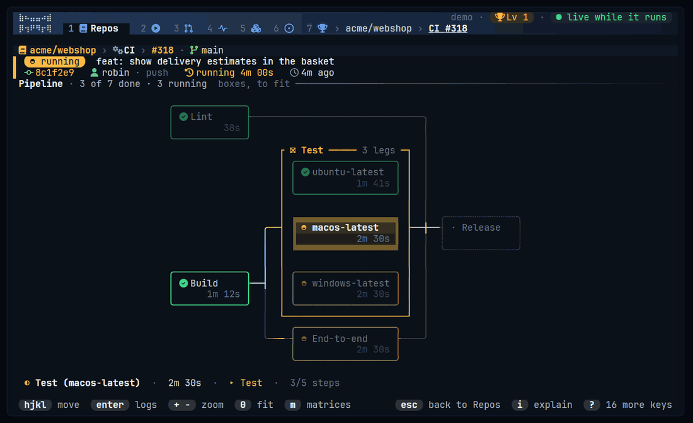
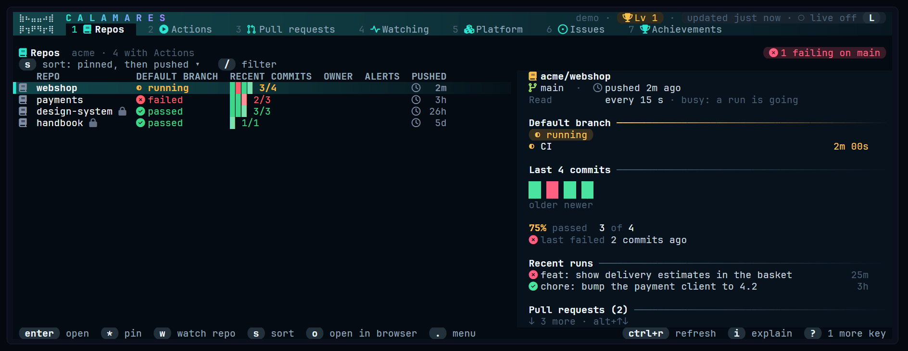
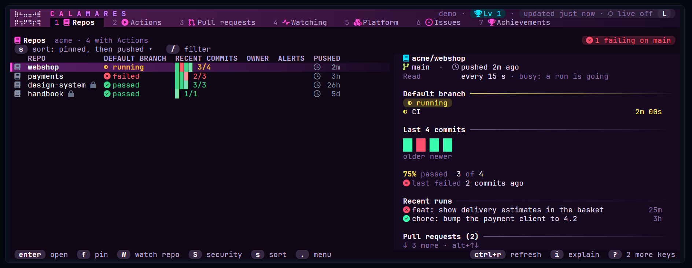
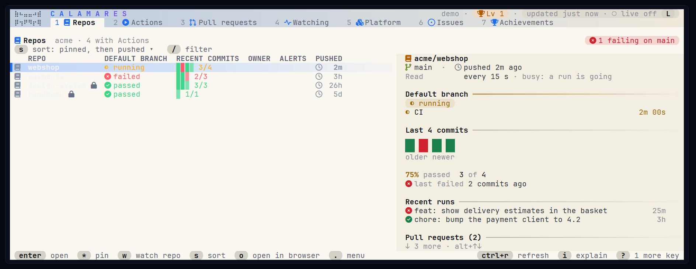

<div align="center">



### GitHub, without leaving your terminal.

Pull requests, issues and Actions in one fast, keyboard-driven command center.

[](https://github.com/vvanouytsel/calamares/releases)
[](go.mod)
[](https://github.com/vvanouytsel/calamares/releases)

</div>



## Why Calamares

<table>
<tr>
<td width="50%" valign="top">

**Everything that needs you, at a glance**<br>
Reviews you owe, runs waiting for approval, questions in issues, counted at the top of each screen.
Every list comes with a panel that tells you what is going on and what to do next.

</td>
<td width="50%" valign="top">

**Act, don't just look**<br>
Review, approve, merge, comment, rerun failed jobs, cancel, dispatch workflows, open pull requests
and issues, publish releases. One key each, and it always asks before it changes anything.

</td>
</tr>
<tr>
<td valign="top">

**Why it failed, straight away**<br>
Open a failed run and land on the failing step, with the failing test, its assertion and which
matrix legs passed. Logs fold by step, highlight errors and can be searched.

</td>
<td valign="top">

**Gentle on your API quota**<br>
Every repo is covered, each read at the pace of how much goes on in it: busy ones every 15 seconds,
untouched ones every 20 minutes, and a push wakes a repo at once. Unchanged answers cost nothing, and
screens open instantly from the last session.

</td>
</tr>
<tr>
<td valign="top">

**Watch a run, get told**<br>
Press `w` and Calamares keeps an eye on it, with a card when it finishes and a desktop notification
when you're in another window.

</td>
<td valign="top">

**Looks the part**<br>
Eight themes, Nerd Font icons in colour, status chips and calm animations, and a plain mode for any
terminal. The mouse stays the terminal's, so text can always be selected.

</td>
</tr>
</table>

## A closer look

**Pull requests** with the conversation, the diff, the checks and everything that still stands
between you and a merge.



**Issues** that concern you, with what they want from you. Can't help right now? `d` sets one
aside until someone writes again.



**Runs** that explain themselves: the jobs and steps at the left, and why it failed at the right.



**Pipelines** that move: press `p` to see the run as a graph, with light running into the jobs that
are still busy. Move around and the job you pick lights up with everything it waits for and
everything that waits for it.



## Pick your look

<table>
<tr>
<td></td>
<td></td>
<td></td>
</tr>
<tr>
<td align="center">abyss</td>
<td align="center">neon</td>
<td align="center">paper</td>
</tr>
</table>

Also **cockpit** (the default), **midnight**, **ember**, **aurora** and **slate**. Press `T` to try the next one, or `:theme`
to pick one with a live preview.

## Get started

Download a binary from [Releases](https://github.com/vvanouytsel/calamares/releases), or build it:

```bash
go install github.com/vvanouytsel/calamares/cmd/calamares@latest
```

Calamares uses your existing `gh auth login`, or a token in `GH_TOKEN` / `GITHUB_TOKEN` (scopes
`repo` and `workflow`). It never asks for a password.

```bash
calamares                    # in a git checkout: opens that repo
calamares --repo owner/name  # open a repo directly
calamares --readonly         # look, never change anything
```

| Key | |
|---|---|
| `1`–`7` | Repos · Actions · Pull requests · Watching · Platform · Issues · Achievements |
| `enter` · `esc` | Open · back |
| `tab` | Next view of the screen |
| `.` | Everything you can do with what's selected |
| `:` | Go to any repo, pull request, workflow or command |
| `i` | What the screen shows: each chip, column and part of the panel |
| `?` | Every key of the screen you're on |

The full guide (every key, filtering and configuration) is in [docs/usage.md](docs/usage.md).

## Development

```bash
go test ./...
go run ./cmd/calamares
```

Commits follow [Conventional Commits](https://www.conventionalcommits.org/); a `feat:` or `fix:` on
`main` publishes a release.
